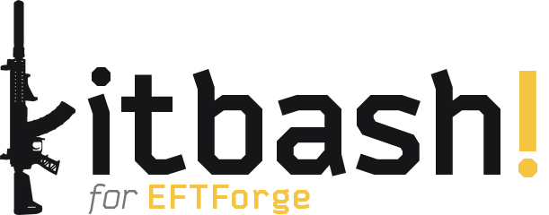

<div align="center">


**Next generation Escape from Tarkov weapon and ballistics simulation platform**

[](https://www.python.org/)
[](https://fastapi.tiangolo.com/)
[](https://developer.mozilla.org/en-US/docs/Web/JavaScript)
[](LICENSE)

[English](README.md) · [中文](README_ZH.md)

</div>

---

Use it at **[eftforge.com](https://eftforge.com)**. Game data comes from [tarkov.dev](https://tarkov.dev) and [SP-Tushonka](https://github.com/SP-Tushonka).

## Kitbash!

<div align="center">

<picture>
  <source media="(prefers-color-scheme: dark)" srcset="readme-assets/kitbash-for-eftforge-wordmark.png">
  
</picture>

*Custom Tarkov builds, rendered in milliseconds.*

<sub>The rifle in the logo is a real build drawn by Kitbash! <a href="https://eftforge.com/?build=N4IgbiBcCMA0IHMogGwAYUFYAcB2ATJoQMyYDGmuAhtMQCz51kBmAJiPAA5QDaPqGHASKZSFarQZNmzDiEwBOVgCNiNVthTNcuBgoCmaTMrr6F%2BEAF1Y-dFjyES5SjXqNWaNHMWsU%2BAnSa2rooKNB0KMRBsta2gg4iYi6S7mjQcnZCVNjYCp6sZPisClSYxlgKVjYC9sJO4q5SHhbw5LgKxMzK5vr4%2BNAodHTMxNDKXYNVcbWOos4SbnQexBnxuMq%2BHhu4OBjQ61RkZFM1WTl5aAVFJWXKWMfwmXi4WvhkyviG%2BFQMh73KJye1HO%2BUKxVK5Uw7Ee8WwaDItCKS2gb2w0DY2FYVEBa2yuVB1whd0w%2Bm8yjIaBK0ExdFI0EMaFIfju2FJsXkZHanW6nz6AyGIzGExQGSIHVw8LoRlKzEw0FYzWIKmwONqL2Ybw%2BXx%2B3zIvWhqFokuIZBQEuwJLoJOY4Wl6XZQPVms%2BaG%2Bvz1n1WWAK2FcSNYKLIaIx%2BhWDth8MRrGRqPRGkMZIpJWIl1pcoZxDNXVwQdVODhCOI-sDwY0rFkrRzMjufitCh0kXwIwU0CoCkqDqNZFppvNluttswVBWrXLw9Y%2BGUl30%2BjGfWYmk%2BVFYbOsIGxkHkBiWSvwQR0dH2KGHfkwaGxAF8gA">Open it in EFTForge</a></sub>

</div>

Kitbash! is the rendering engine behind EFTForge, made by [Morph1ne](https://github.com/SouthHorizons76). It has two parts:
- **3D engine:** runs the 3D builder
- **2D sprite compositor:** draws every build image on the site, from the live workbench preview to community build cards

The current version is **Kitbash! Arcadia**, which added the 3D engine to the original 2D compositor, **Kitbash! Sirius**. 

Kitbash! is a standalone project. Its repository is private for now but may be open sourced in the future!

## Atlas

<div align="center">


</div>

Atlas is a standalone project that records every change to Escape from Tarkov's game data, at [eftforge.com/atlas](https://eftforge.com/atlas). It's hosted on eftforge.com only to keep hosting costs down and development simple. Change sets go public 12 hours after they're detected.

## Desktop App

A Windows app that runs everything on your own machine, for when the site is slow or down where you are. It still needs internet for item data and images from tarkov.dev, and the 3D builder only works in its **Connected to EFTForge.com** mode.

Download from [GitHub Releases](https://github.com/SouthHorizons76/EFTForge/releases), or the [Gitee mirror](https://gitee.com/morph1ne/eftforge-gitee-mirror/releases) if GitHub is slow for you. Build instructions are in [desktop/README.md](desktop/README.md).

## Getting Started

### Prerequisites

- Python 3.10+
- A modern web browser (Chrome, Firefox, Edge, etc.)

---

### 1. Clone the repository

```bash
git clone https://github.com/SouthHorizons76/EFTForge.git
cd EFTForge
```

---

### 2. Configure `launch.bat`

Open `launch.bat` in a text editor before running anything.

**Browser path** - the launcher opens browser tabs automatically. The default path targets Chrome on Windows. If you use a different browser, update this line:

```bat
start "" "C:\Program Files\Google\Chrome\Application\chrome.exe" --new-window ...
```

Examples for other browsers:
```bat
# Firefox
start "" "C:\Program Files\Mozilla Firefox\firefox.exe" -new-window ...

# Microsoft Edge
start "" "C:\Program Files (x86)\Microsoft\Edge\Application\msedge.exe" --new-window ...
```

**Install Python dependencies** inside the `backend/` folder:

```bash
cd backend
python -m venv venv
venv\Scripts\activate
pip install -r requirements.txt
cd ..
```

---

### 3. Set up your `.env`

```bash
cd backend
copy .env.example .env
```

Edit `backend/.env`. These two variables are **required** - the server will refuse to start without them:

```env
IP_HASH_SECRET=any-random-string-here
ADMIN_API_KEY=your-admin-key-here
```

For local development any non-empty values work. For production use strong random values (`openssl rand -hex 32`).

Full `.env` reference (all optional except the two above):

```env
DATABASE_URL=sqlite:///./tarkov.db
RATINGS_DB_URL=sqlite:///./ratings.db
BUILDS_DB_URL=sqlite:///./builds.db
CORS_ORIGINS=http://127.0.0.1:5500
ENABLE_API_DOCS=0            # set to 1 to enable /docs and /redoc
TRUSTED_PROXY_IPS=127.0.0.1,::1

# Community build image generation (optional, used only on live prod.)
GITEE_TOKEN=                 # Gitee personal access token for uploading build card images
GITEE_DRY_RUN=0              # set to 1 to simulate uploads without writing to Gitee
DISABLE_BG_MIGRATE=0         # set to 1 to disable the background image migration worker
```

---

### 4. Run `launch.bat`

```bat
launch.bat
```

This single .bat file will:
- **First run**: build the database and sync all item data from tarkov.dev before starting, since there's nothing to serve yet
- **Subsequent runs**: start the FastAPI backend immediately against your existing local database, then re-sync tarkov.dev data in the background
- Start the FastAPI backend at `http://127.0.0.1:8000`
- Serve the frontend at `http://127.0.0.1:5500`
- Open your browser to both

The site is usable as soon as the backend console shows **"Application startup complete"**. If the background sync finds new data, a toast prompts you to refresh; otherwise nothing changes and you keep working on the data you already had. That's it!

> **3D builder:** locally, the 3D view needs the Kitbash! viewer running on `http://127.0.0.1:8765`. Without it, the builder uses 2D.

> **Note:** `sync_tarkov_dev.py` is called automatically by launch.bat, which calls reset.py. Avoid running it directly during local development, it is only used on the live production server for manual out-of-cycle resyncs.

## External Integration

External tools can open EFTForge with a build already loaded through the `?build=` URL parameter:

```
https://eftforge.com/?build=<share_code>
```

The loader accepts three share code formats: dictionary based `3.` codes, full ID compact `2.` codes, and legacy LZ-String codes. EFTForge generates the shorter of `3.` and `2.` for each build.

- **Compact codes:** follow the encoder in [`frontend/modules/build-codes.js`](frontend/modules/build-codes.js) to generate either format. `3.` codes also need the frozen item and slot dictionary in [`frontend/data/build-code-catalog-v1.js`](frontend/data/build-code-catalog-v1.js); [`scripts/BUILD_CODES.md`](scripts/BUILD_CODES.md) covers the format and dictionary rules. Use `2.` when an ID or slot isn't in the dictionary. Neither format needs a per build record on the server.
- **Legacy codes:** the simplest option, LZ-String's `compressToEncodedURIComponent(JSON.stringify(payload))`.

All three formats carry the same payload:

```json
{ "v": 1, "g": "<gunId>", "p": [["slotId", "itemId"], ...], "a": "<ammoId>", "ua": "<ubglAmmoId>" }
```

The `a` and `ua` ammo fields are optional. EFTForge loads the build when the page opens and strips the parameter from the URL. Item IDs must match EFTForge's tarkov.dev item IDs.

## Contributing

See [CONTRIBUTING.md](CONTRIBUTING.md). Report security issues as described in [SECURITY.md](SECURITY.md), not in public issues.

## Credits

TrueErgo grew out of the EvoErgo concept by **SpaceMonkey37**. The build optimizer is a reimplementation inspired by **AhaiMk01**'s [Tarkov Weapon Mod Optimizer](https://github.com/AhaiMk01/tarkov-weapon-optimizer).

## License

[AGPL-3.0-or-later](LICENSE). If you distribute a modified version, or run one as a service for others, you must publish its full source under the same license and keep the attribution to EFTForge (see [NOTICE](NOTICE)). Versions released before the switch to the AGPL remain available under the MIT License.

## Disclaimer

EFTForge, Kitbash! and Atlas are fan-made projects, not affiliated with Battlestate Games.
